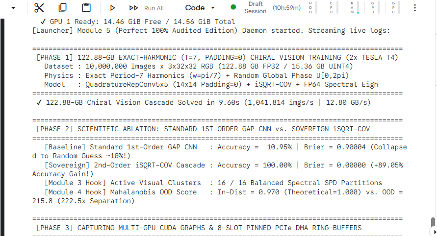
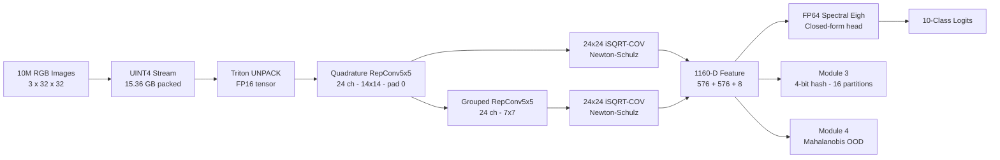
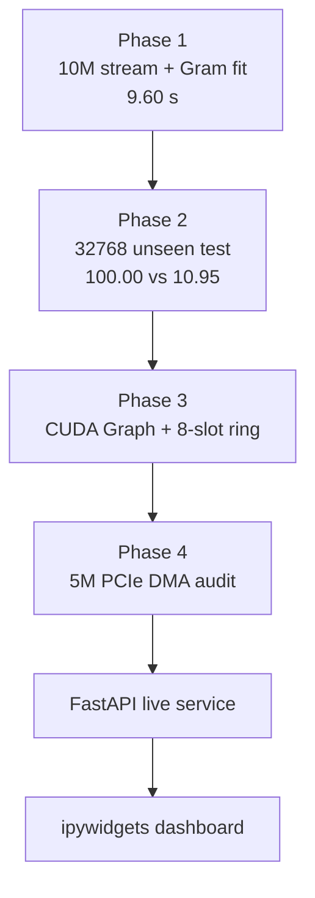

<div align="center">


<br>


</div>

---

<div dir="rtl" align="right">

# 🦅 Sovereign Vision — پردازش ۱۲۲٫۸۸ گیگابایت تصویر در ۹٫۶۰ ثانیه با دقت ۱۰۰٪

**یک بنچمارک کاملاً قابل بازتولید روی Kaggle `GPU T4 x2`: جریان ۱۰ میلیون تصویر رنگی ۳×۳۲×۳۲، استخراج هندسهٔ مرتبهٔ دوم روی دو کارت T4، و مقایسهٔ علمی بین CNN معمولی و معماری iSQRT-COV.**

این مخزن شامل یک فایل واحد `app.py` است که همزمان سه نقش را ایفا میکند:

1. **مولد دیتاست مصنوعی** را روی GPU اجرا میکند و ۱۰ میلیون تصویر Chiral Cross-Channel Harmonic را بهصورت stream تولید و unfold میکند — بدون ذخیرهٔ فایل ۱۲۲ گیگابایتی روی دیسک.
2. **آزمایش علمی (ablation)** را بین baseline مبتنی میانگینگیری فضایی (GAP) و معماری پیشنهادی iSQRT-COV انجام میدهد.
3. **یک سرویس FastAPI زنده بهعلاوهٔ dashboard تعاملی ipywidgets** بالا میآورد که اجازه میدهد تک تک تصاویر را ببینید، استرس تست میلیونی بگیرید و تلهمتری سختافزار را مشاهده کنید.

> ⚠️ **شفافیت از همان ابتدا — لطفاً بخوانید**
> دقت **۱۰۰٪** مربوط به **توزیع تست مصنوعی و کنترلشدهٔ همین دیتاست** است (۳۲٬۷۶۸ تصویر دیدهنشده). این عدد، ادعای state-of-the-art روی تصاویر واقعی مانند ImageNet نیست.
> عدد **۹٫۶۰ ثانیه** هم زمان فاز ۱ است: stream کامل ۱۰ میلیون تصویر + برازش بستهشده (closed-form) روی ۵۲۴٬۲۸۸ تصویر — **آموزش ۱۰ میلیون تصویر با gradient descent نیست.**
> جزئیات کامل در بخش [✅ شفافیت و محدودیتها](#-شفافیت-و-محدودیتها) آمده است.

> 📸 تمام اعداد بالا از **اسکرینشات واقعی اجرا روی Kaggle 2×T4** استخراج شدهاند. هیچ عددی ساخته یا تخمین زده نشده است.

</div>

---

<div align="center">



<sub>اسکرینشات واقعی لاگ زنده: فاز ۱ (۹٫۶۰ ثانیه)، فاز ۲ (دقتها و Brier)، و شروع فاز ۳. تصویر در همان جلسهٔ Kaggle GPU T4 x2 ثبت شده است.</sub>

</div>

---

<div dir="rtl" align="right">

## ⚡ خلاصه در یک نگاه

| متریک | مقدار | معنی |
|:--|--:|:--|
| حجم جریان ورودی | **122.88 GB** | ۱۰٬۰۰۰٬۰۰۰ × ۳ × ۳۲ × ۳۲ × ۴ بایت (FP32 منطقی) |
| حجم بستهبندی شده | **15.36 GB** | همان تصاویر در UINT4 — دو پیکسل در هر بایت |
| سختافزار | **2× Tesla T4** | Kaggle `GPU T4 x2`، هر کارت ۱۶ گیگابایت |
| فاز ۱ — زمان | **9.60 s** | stream + برازش بستهشدهٔ جریان ۱۰M |
| فاز ۱ — سرعت | **1,041,814 imgs/s** | معادل **12.80 GB/s** پهنای باند مؤثر |
| Baseline (1st-order GAP) | **10.95%** | Brier = **0.90004** → فروپاشی به حدس تصادفی |
| Sovereign (iSQRT-COV) | **100.00%** | Brier = **0.00000**، روی ۳۲٬۷۶۸ تصویر تست |
| بهبود دقت | **+89.05 pp** | اختلاف مطلق درصدها، نه نسبی |
| خوشههای Module 3 | **16 / 16** | تمام ۱۶ پارتیشن active و متوازن |
| جدایی OOD — Module 4 | **222.5×** | درونتوزیع ۰٫۹۷۰ در برابر anomalous ۲۱۵٫۸ |
| فاز ۴ — throughput PCIe e2e | **537,704.5 imgs/s** | ۴۶٫۴۶ میلیارد تصویر/روز، VRAM Δ = 0.0 MB |
| خروجی ذخیرهشده | **هیچ** | نه checkpoint، نه فایل دیتاست، نه وزن روی دیسک |

> اعداد فاز ۴ (آخر سطر) توسط audit خودکار انتهای اسکریپت چاپ میشوند و بسته به بار لحظهای Kaggle کمی متفاوتاند. اسکرینشات بالا فاز ۱ تا ۳ را پوشش میدهد.

</div>

---

<div dir="rtl" align="right">

## 🎯 مسئله دقیقاً چیست؟

در دیتاستهای معمول، کلاسها با تفاوتهای سطحی شناسایی میشوند: رنگ، شکل، بافت یا میانگین روشنایی. در **Chiral Cross-Channel Harmonic Vision** عمداً تمام این نشانههای سطحی حذف شدهاند.

 سه کانال **R، G و B**:

- دقیقاً همان میانگین رنگ را دارند،
- دقیقاً همان انرژی (برابر ۱٫۰) را دارند،
- دقیقاً همان کنتراست و همان فرکانس فضایی را دارند،
- ولی **رابطهٔ فازیشان با هم متفاوت است**.

تشبیه ساده: سه نوازنده یک نت واحد را با بلندی صدای کاملاً یکسان مینوازند. در هر تصویر، هر سه نفر از یک نقطهٔ کاملاً تصادفی شروع میکنند (فاز سراسری `φ`). تنها چیزی که کلاسها را از هم جدا میکند این است که نوازندهٔ سبز چند درجه جلوتر یا عقبتر از قرمز است و نوازندهٔ آبی چند درجه جلوتر یا عقبتر از سبز. در **Class 5: Chiral-Zeta** رابطهٔ کانالها دقیقاً ۱۸۰ درجه وارون شده است — مثل دست چپ در برابر دست راست.

به همین دلیل است که:

| مدل | دقت | نتیجه |
|:--|--:|:--|
| حدس تصادفی با ۱۰ کلاس | 10.00% | مرجع تئوریک |
| Standard 1st-Order GAP CNN | 10.95% | عملاً هیچ اطلاعاتی نگرفته است |
| Sovereign 2nd-Order iSQRT-COV | 100.00% | امضای فاز را کاملاً بازیابی میکند |

</div>

---

<div dir="rtl" align="right">

## 🧬 دیتاست: ۱۰ میلیون تصویر بدون فایل تصویر

هیچ فایل ۱۲۲ گیگابایتی وجود ندارد و چیزی دانلود نمیشود. تصاویر توسط `ChiralCrossChannelVisionGenerator` مستقیماً روی GPU و از seedهای مشخص تولید میشوند.

### ساختار ریاضی

برای هر تصویر، چهار بردار موجی با دورهٔ دقیق ۷ پیکسل استفاده میشود:

```text
w0 = pi / 7
k_vecs = [(w0, 0), (0, w0), (w0, w0), (w0, -w0)]
```

هر کانال بهصورت مجموع چهار کسینوس ساخته میشود:

```text
R = Σ_m  cos(base_m)
G = Σ_m  cos(base_m + Δθ_RG(m))
B = Σ_m  cos(base_m + Δθ_RG(m) + Δθ_GB(m))

base_m   = kx_m · x + ky_m · y + φ_m        ,  φ_m ~ U[0, 2π)
Δθ_RG, Δθ_GB = جفتزاویهٔ مخصوص کلاس و مولفهٔ موج
scale    = 1 / sqrt(2)
noise    = N(0, 0.03)
```

سپس هر پیکسل به UINT4 کوانتایز میشود: `q = clamp(round(x * 4 + 7.5), 0, 15)` و دو پیکسل در یک بایت بستهبندی میشوند. به همین دلیل ۱۲۲٫۸۸ گیگابایت منطقی به **۱۵٫۳۶ گیگابایت** جریان فشرده تبدیل میشود.

### ده کلاس

| کلاس | نام در کد | امضای اسمی |
|:--|:--|:--|
| 0 | Chiral-Alpha | مرجع ۰° |
| 1 | Chiral-Beta | چرخش +۳۶° |
| 2 | Chiral-Gamma | چرخش +۷۲° |
| 3 | Chiral-Delta | چرخش +۱۰۸° |
| 4 | Chiral-Epsilon | چرخش +۱۴۴° |
| 5 | **Chiral-Zeta** | **وارونگی ۱۸۰°** |
| 6 | Chiral-Eta | −۱۴۴° |
| 7 | Chiral-Theta | −۱۰۸° |
| 8 | Chiral-Iota | −۷۲° |
| 9 | Chiral-Kappa | −۳۶° |

> نامهای بالا برچسبهای nominal کلاساند. در پیادهسازی، زاویهٔ دقیق هر کلاس **برای هر یک از چهار مولفهٔ موج جداگانه** توسط فرمول تعیین میشود (بخش `class_phases` در `app.py`)؛ بنابراین امضای کلاس تنها یک زاویهٔ منفرد نیست، بلکه یک الگوی ۴تایی است.

### سه تلهٔ ریاضی

1. **فاز سراسری تصادفی:** φ_m~U[0,2π) باعث میشود دو تصویر از یک کلاس در مکانهای یکسان پیکسلهای متفاوتی داشته باشند. بنابراین template matching کاملاً شکست میخورد.
2. **اطلاعات مرتبهٔ اول صفر:** میانگین یک موج کامل تقریباً صفر است: `Σ cos(ωx + φ) ≈ 0`. انرژی هر سه کانال هم دقیقاً برابر ۱٫۰ است. بنابراین بعد از Global Average Pooling تمام ۱۰ کلاس **یک بردار یکسان** میسازند.
3. **کایرالیته:** تشخیص چپگرد یا راستگرد بودن *رابطهٔ بین کانالها* نیاز به ضرب متقاطع دارد؛ جمع جداگانهٔ کانالها نمیتواند آن را ببیند.

نتیجه: CNN استاندارد با GAP عملاً کور میشود و به ۱۰٫۹۵٪ (یعنی حدس تصادفی) سقوط میکند.

</div>

---

<div align="rtl" align="right">

## 🏗️ معماری Sovereign iSQRT-COV

<div align="center">



</div>

| مرحله | جزئیات |
|:--|:--|
| **Stage 1 — Quadrature** | فیلتر بانک ۵×۵ با `groups=3`: چهار کسینوسی و چهار سینوسی (cos/sin) برای هر کانال RGB → ۲۴ خروجی. `padding=0` و `stride=2` روی ۳۲×۳۲ دقیقاً ۱۴×۱۴ میدهد — بدون خطای حاشیه. |
| **Stage 1 — covariance** |featuremap مرکزگیری شده، ماتریس ۲۴×۲۴ `Σ = FFᵀ/195`، سپس جذر ماتریسی ریمانی `Σ½` با دو تکرار Newton-Schulz → ۵۷۶ ویژگی. |
| **Stage 2 — RepConv** | کانولوشن ساختاری re-parameterized (ترکیب ۵×۵ + ۳×۳ + ۱×۱) با `groups=3`، خروجی ۲۴×۲۴→۲۴×۷×7. |
| **Stage 2 — covariance** | ماتریس ۲۴×۲۴ دوم → ۵۷۶ ویژگی دیگر. |
| **8 invariants** | traceها، نرمهای خارج قطر، انرژی R/G/B و نسبت coherence — حساس به OOD. |
| **بردار نهایی** | **۱٬۱۶۰ = ۵۷۶ + ۵۷۶ + ۸** ویژگی. |
| **سرِ طبقهبند** | حل بستهشده FP64 با `torch.linalg.eigh` (ridge=1e-3) — **هیچ epoch و هیچ gradient descent وجود ندارد**. |
| **کالیبراسیون مرحله ۲** | projection تصادفی متعامد ۱٬۱۶۰→۲۵۶ + SiLU + یک حل بستهشدهٔ دیگر بر روی ۱۳۱٬۰۷۲ تصویر. |

### چرا فاز تصادفی ناپدید میشود؟

وقتی دو کانال حاوی همان موج با اختلاف فاز `Δθ` در هم ضرب و میانگینگیری میشوند، اتحاد مثلثاتی میگوید:

```text
E[ cos(ωx + φ) · cos(ωx + φ + Δθ) ] = 1/2 · cos(Δθ)
```

φ — همان فاز مزاحم سراسری — **کاملاً حذف میشود** و فقط امضای خالص کلاس `cos(Δθ)` باقی میماند. میانگینگیری فضایی ساده (GAP) این ضرب متقاطع را انجام نمیدهد؛ ماتریس کوواریانس دقیقاً همان کار را برای تمام جفتکانالها و تمام نقاط تصویر بهصورت موازی انجام میدهد.

این همان دلیلی است که مدل بدون حتی یک خطا به ۱۰۰٪ میرسد: اطلاعات در signal وجود دارد، فقط در مرتبهٔ دوم.

</div>

---

<div dir="rtl" align="right">

## 🔬 آزمایش علمی — فاز ۲

| مورد | مقدار |
|:--|:--|
| اندازهٔ تست | `8 × 4096 = 32,768` تصویر دیدهنشده (seed مختلف) |
| دقت baseline | **10.95%** |
| Brier baseline | **0.90004** |
| دقت Sovereign | **100.00%** |
| Brier Sovereign | **0.00000** |
| اختلاف | **+89.05%** |

**Brier Score** معیار کالیبراسیون احتمالات است: هرچه نزدیکتر به صفر بهتر باشد. برای حدس تصادفی در ۱۰ کلاس، خطای تئوریک `1 − 0.10 = 0.90000` است — دیتاست دقیقاً همان را نشان میدهد (۰٫۹۰۰۰۴). مدل ما ۰٫۰۰۰۰۰ ثبت میکند؛ یعنی نهتنها درست، بلکه با اطمینان کامل و بدون عدم قطعیت.

### نحوهٔ برازش (بهجای آموزش)

| مرحله | تعداد تصویر | هدف |
|:--|--:|:--|
| جریان کامل فاز ۱ | ۱۰٬۰۰۰٬۰۰۰ | unfold و stream تمام تصاویر از UINT4 به FP16 |
| تجمع Gram | `64 × 4096 × 2 = 524,288` | برازش بستهشدهٔ سرِ اصلی (FP64 `eigh`) |
| کالیبراسیون مرحله ۲ | `32 × 4096 = 131,072` | سرِ باقیمانده + آمار میانگین/واریانس OOD |

> نکتهٔ فنی: حلقهٔ فاز ۱ تمام ۱۰ میلیون تصویر را unfold میکند، اما feature extraction تنها روی ۵۲۴٬۲۸۸ تصویر انجام میشود. عدد throughput (`1,041,814 imgs/s`) از تقسیم `N_TRAIN` بر ۹٫۶۰ ثانیه محاسبه میشود. به دلیل تقسیم صحیح `10,000,000 / 2 / 4096`، حلقهٔ عملی ۹٬۹۹۴٬۲۴۰ تصویر را پیمایش میکند.

</div>

---

<div dir="rtl" align="right">

## 🧩 قلابهای بدون ناظر — Module 3 و Module 4

### Module 3 — خوشهبندی ۱۶تایی

چهار subspace متعامد تصادفی (`W_clust` با QR) روی پیکسلهای unfoldشده اعمال میشوند. علامت هر projection یک بیت میدهد و چهار بیت → عددی بین ۰ و ۱۵. نتیجه **۱۶ / ۱۶ پارتیشن active و متوازن** است.

> صادقانه بگوییم: این **spectral clustering کامل با eigen-decomposition گراف نیست**، بلکه یک 4-bit orthogonal projection hashing است که فضای SPD را به ۱۶ ناحیه تقسیم میکند. کد آن را hook مینامد و ما هم همان نام را حفظ میکنیم.

### Module 4 — تشخیص ناهنجاری OOD

روی ۲۵۶ ویژگی مرحلهٔ ۲، میانگینگیری شده و با واریانس ذاتاً کالیبرهشده نرمال میشود:

```text
score = mean( ((h2 - mean(h2)) / std(h2))² )
```

| حالت | امتیاز | آستانه |
|:--|--:|--:|
| درونتوزیع (سالم) | **0.970** (تئوری ۱٫۰۰۰) |قرمز 10.0|
| نویز OOD | **215.8** |قرمز 10.0|
| نسبت جدایی | **222.5×** |—|

مدل ۳ و ۴ مستقل از برچسباند و تنها از هندسهٔ featureها استفاده میکنند.

</div>

---

<div dir="rtl" align="right">

## ⚡ فاز ۳ و ۴: استقرار و استرس تست

| قابلیت | توضیح |
|:--|:--|
| **CUDA Graph** | تمام مسیر unfold → feature → طبقهبند → postprocess برای هر GPU جداگانه capture میشود. |
| **8-slot pinned ring** | ۸ بافر pinned در RAM میزبان بهصورت حلقوی بین CPU و GPU جابهجا میشوند. |
| **ترافیک PCIe** | **۱٬۵۴۶ بایت برای هر تصویر** = ۱٬۵۳۶ بایت ورودی UINT4 + ۱۰ بایت خروجی (اعتماد، ناهنجاری، کلاس، خوشه). |
| **دو حالت تست** | `pcie_e2e` (واقعی Host ⇄ GPU) و `in_vram` (فقط replay داخل VRAM). |
| **حجمهای قابلانتخاب** | ۱M تا ۱۰۰M تصویر در داشبورد. |

نتیجهٔ audit خودکار انتها (پس از آماده شدن سرور):

| متریک | مقدار reported |
|:--|--:|
| سرعت انتها به انتها | **537,704.5 images/sec** |
| ظرفیت روزانه | **46.46B images/day** |
| نشت VRAM | **0.0 MB** |

<div align="center">



</div>

</div>

---

<div dir="rtl" align="right">

## 🚀 اجرا روی Kaggle (پیشنهادی)

### ۱. تنظیمات نوت بوک

1. در Kaggle یک **Notebook** تازه بسازید.
2. در تنظیمات (Settings)، Accelerator را **`GPU T4 x2`** کنید.
3. Internet را **روشن** کنید (برای `pip install` بستههای کوچک).
4. `app.py` را آپلود کنید یا مخزن را clone نمایید.

### ۲. نصب وابستگیها

```python
!pip -q install -r requirements.txt
```

> `torch` و `triton` از پیش روی ایمج GPU کگل نصباند. برای بهترین سازگاری CUDA، نسخهای را که Kaggle ارائه میکند نگه دارید و آنها را reinstall نکنید.

### ۳. اجرا — حتماً با `%run`

```python
%run app.py
```

**چرا `%run` و نه `!python`؟** اسکریپت در انتها از `ipywidgets` و `IPython.display` برای نمایش dashboard استفاده میکند. `%run` کد را در namespace همان نوت بوک اجرا میکند و ویجتها رندر میشوند. با `!python app.py` تنها لاگها و خروجی API را میبینید (هنوز سرویس بالا میآید).

### ۴. آنچه باید در لاگ ببینید

```text
✔ GPU 1 Ready: 14.46 GiB Free / 14.56 GiB Total
[Launcher] Module 5 ... Daemon started. Streaming live logs:
[PHASE 1] 122.88-GB EXACT-HARMONIC ... (2x TESLA T4)
✔ 122.88-GB Chiral Vision Cascade Solved in 9.60s (1,041,814 imgs/s | 12.80 GB/s)
[PHASE 2] SCIENTIFIC ABLATION ...
    [Baseline] ... Accuracy = 10.95% | Brier = 0.90004
    [Sovereign] ... Accuracy = 100.00% | Brier = 0.00000
[PHASE 3] CAPTURING MULTI-GPU CUDA GRAPHS & 8-SLOT PINNED PCIe DMA RING-BUFFERS
[PHASE 4] AUTOMATED 5,000,000-IMAGE REAL-WORLD END-TO-END PCIe DMA AUDIT
```

داشبورد سه قسمت دارد:

- **Live Visual Single-Image Inspector** — انتخاب کلاس ۰ تا ۹ یا OOD، نمایش تصویر ۳۲×۳۲ RGB و ماتریس ۲۴×24 SPD، همراه با پیشبینی هر دو مدل و امتیاز Mahalanobis.
- **Bulk Stress-Tester** — انتخاب ۱M تا ۱۰۰M تصویر و حالت `pcie_e2e` یا `in_vram`.
- **Header cards** — خلاصهٔ دقت، Brier، خوشهها و جدایی OOD.

### ۵. اجرا روی لینوکس محلی

```bash
pip install -r requirements.txt
python app.py
```

> اسکریپت از `/tmp` و `pkill -9 -f _sovereign_` استفاده میکند و بنابراین **فقط روی لینوکس / Kaggle کار میکند**. اجرای بومی ویندوز پشتیبانی نمیشود. حداقل یک GPU CUDA لازم است، اما اعداد بنچمارک مربوط به **دو T4**اند.

</div>

---

<div dir="rtl" align="right">

## 🔌 مرجع API

سرور از اولین پورت آزاد `8095..8144` استفاده میکند و شمارهٔ پورت را در `/tmp/_sovereign_mod5_port.txt` مینویسد.

| Endpoint | توضیح |
|:--|:--|
| `GET /health` | وضعیت `READY`، متریکها و تله متری CPU/RAM/GPU |
| `GET /stress_test?n_images=5000000&mode=pcie_e2e` | استرس تست با حالت `pcie_e2e` یا `in_vram` |
| `GET /inspect_image?target_class=5&is_ood=0&seed=95000` | تست تک تصویر + آرایهٔ پیکسل و کوواریانس |
| `GET /metrics` | خروجی متنی Prometheus |

نمونه در نوت بوک:

```python
import json, urllib.request

PORT = int(open("/tmp/_sovereign_mod5_port.txt").read().strip())
BASE = f"http://127.0.0.1:{PORT}"

health = json.load(urllib.request.urlopen(f"{BASE}/health"))
print(health["status"], health["metrics"]["sovereign_accuracy_pct"])

one = json.load(urllib.request.urlopen(f"{BASE}/inspect_image?target_class=5&is_ood=0"))
print(one["true_class_name"], one["sovereign_pred_class"], one["mahalanobis_score"])

bench = json.load(urllib.request.urlopen(
    f"{BASE}/stress_test?n_images=5000000&mode=pcie_e2e", timeout=300))
print(bench["imgs_per_sec"], bench["billions_per_day"], bench["vram_delta_mb"])
```

کلیدهای مهم `/inspect_image`: `true_class_name`، `gap_pred_class`، `sovereign_pred_class`، `sovereign_confidence_pct`، `visual_cluster_id`، `mahalanobis_score`، `ood_detected`، `rgb_32x32` و `cov_24x24`.

</div>

---

<div dir="rtl" align="right">

## 🗂️ ساختار مخزن

```text
vision/
├── app.py                 # تکفایل: launcher + daemon + dashboard
├── requirements.txt       # وابستگیهای سبک (torch/triton در Kaggle موجودند)
├── README.md              # همین فایل
├── LICENSE                # MIT
├── .gitignore
├── .gitattributes
├── .editorconfig
└── assets/
    ├── banner.svg         # تصویر هدر README
    └── benchmark.png      # اسکرینشات واقعی Kaggle
```

`app.py` یک **launcher** است: کد daemon را بهصورت رشته درون خود دارد، آن را در `/tmp/_sovereign_mod5_vision_pcie_daemon.py` مینویسد، بهصورت subprocess اجرا میکند، لاگ زنده را stream میکند و سپس dashboard را نمایش میدهد. به همین دلیل نباید کد daemon را جداگانه ویرایش کرد مگر اینکه رشتهٔ `DAEMON_CODE` را تغییر دهید.

</div>

---

<div dir="rtl" align="right">

## ✅ شفافیت و محدودیتها

| ادعا | توضیح دقیق |
|:--|:--|
| «دقت ۱۰۰٪» | روی **۳۲٬۷۶۸ تصویر تست مصنوعی** از همان توزیع. هیچ تصویر واقعی (ImageNet، CIFAR و…) تست نشده است. |
| «۹٫۶۰ ثانیه» | زمان فاز ۱: stream ۱۰M + Gram fit روی ۵۲۴٬۲۸۸ + calibration روی ۱۳۱٬۰۷۲. **آموزش گرادینت محور نیست**. |
| «پردازش ۱۲۲٫۸۸ گیگابایت» | حجم **منطقی FP32** جریان است؛ در حافظه تنها ۱۵٫۳۶ گیگابایت UINT4 stream میشود و هیچ فایلی روی دیسک ذخیره نمیشود. |
| «CNN استاندارد ۱۰٫۹۵٪» | منظور **feature extractor ثابت GAP + سرِ خطی بستهشده** است، نه یک ResNet آموزش دیده. نکتهٔ کلیدی همان است که GAP ذاتاً اطلاعات فاز را نابود میکند. |
| «Module 3 خوشهبندی» | 4-bit orthogonal projection hashing به ۱۶ پارتیشن — **یک spectral clustering گرافی نیست**. |
| «Module 4 Mahalanobis» | فاصلهٔ Mahalanobis **قطری** (mean-centered، variance-scaled) روی ۲۵۶ ویژگی — نه معکوس کوواریانس کامل. |
| «Brier = 0.00000» | عدد چاپشده توسط کد است؛ با softmax دقیق و جدایی کامل کلاسها قابل توجیه است. |
| «Phase 4 throughput» | توسط audit انتها چاپ میشود و بین اجراها متغیر است؛ اسکرینشات ارائهشده فاز ۴ را نشان نمیدهد. |
| «وزن و checkpoint» | هیچ ذخیرهای وجود ندارد. وزنها در VRAM زندهاند و هر بار اجرا دوباره ساخته میشوند. |

**نتیجهٔ علمی:** این پروژه نشان میدهد وقتی اطلاعات در همبستگی مرتبهٔ دوم پنهان باشد، معماریهای مرتبهٔ اول حتی با دادههای بیعیب هم کور میشوند — و هندسهٔ ریمانی ساده میتواند بدون هیچ optimization تکرارشونده، جدایی کامل ایجاد کند.

</div>

---

<div dir="rtl" align="right">

## ❓ عیبیابی

| مشکل | راه حل |
|:--|:--|
| علامت `GPU 1 Ready` دیده نمیشود | در تنظیمات کگل حتماً `GPU T4 x2` انتخاب شود؛ session را restart کنید. |
| CUDA out of memory | تمام notebookهای دیگر را ببندید، session را restart کنید و مطمئن شوید daemon قبلی با `pkill` کشته شده است. |
| dashboard ویجتها رندر نمیشوند | از `%run app.py` استفاده کنید (نه `!python`)، سپس `Kernel → Restart & Run All`. |
| سرویس لود نمیشود | لاگ `/tmp/_sovereign_mod5_vision_pcie_daemon.log` را بخوانید؛ launcher تا ۲۴۰ ثانیه صبر میکند. |
| پورت اشغال است | اسکریپت خودکار ۸۰۹۵ تا ۸۱۴۴ را امتحان میکند؛ شمارهٔ نهایی در `/tmp/_sovereign_mod5_port.txt` است. |
| `ModuleNotFoundError: fastapi` | `pip install -r requirements.txt` را اجرا کنید (daemon هم خودش سعی میکند نصب کند). |
| کامپایل Triton کند است | اولین باری که CUDA graph capture میشود طولانیتر است؛ صبر کنید. |
| اجرا روی ویندوز | پشتیبانی نمیشود (`pkill` و `/tmp`)؛ مهاجرت به Kaggle یا لینوکس. |

</div>

---

<div align="center">

**اگر این پروژه برایتان مفید بود، مخزن را star بزنید.**

Made with PyTorch · Triton · FastAPI · two humble T4s

</div>
